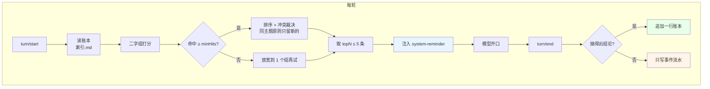
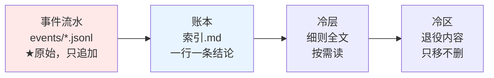
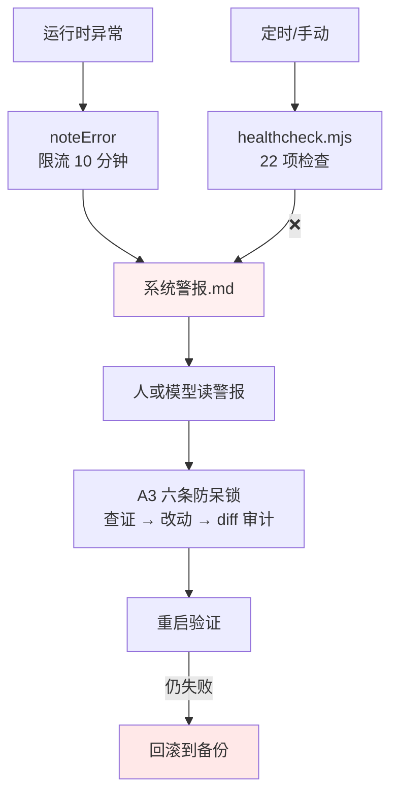

# dsh-inner-loop

> 给 LLM 助手装一个**会记得、会认错、不敢瞎改**的内循环。

**一句话**：每轮结束自动把「发生了什么」沉淀成一行结论；下一轮只把**真正相关**的 3 条喂回上下文；并且强制它在说"搞定了"之前回读一遍自己改的东西。

---

## 它治三个病（Why）

| 病 | 症状 | 这套给的解药 |
|---|---|---|
| **失忆** | 新会话不记得上次；同一件事问两遍；"你之前说过"——它一脸茫然 | `turn/end` 自动沉淀 + 二字组检索，每轮注入 ≤3 条 |
| **幻觉** | 顺嘴报数（"你打了两个字"，实际一个）；没查就说"应该没问题" | 数量必须来自工具返回 · 结论必须能追到出处 |
| **瞎改** | 没查就动手；改完不复核；把"改了"说成"搞定了" | 动手前三问 · A3 六条防呆锁 · 改完必须回读 |

三个病的共同点：**都不是模型"不会"，是它"没停一下"**。
所以这套东西不教模型知识，只**在几个固定的地方强制它停一下**。

---

## 30 秒跑起来（How）

```bash
# 1. 装插件
pnpm add dsh-inner-loop          # 或 npm i dsh-inner-loop

# 2. 把骨架模板放进你的全局指令文件，替换里面的 <占位符>
cp rules-template/AGENTS.template.md  ~/.dsh/AGENTS.md
#    占位符清单见 rules-template/PLACEHOLDERS.md

# 3. 写规矩细则（A1–A7）
cp rules-template/behavior-rules.md   ~/.dsh/记忆库/规则/

# 4. 体检：全绿再开工
node tools/healthcheck.mjs
```

**没有第 5 步。** 它不需要数据库、不需要向量模型、不联网 —— 全靠几个 `.md` 文件。

---

## 架构（Architecture）



**三层记忆**（原始 → 派生 → 归档）：



> **只有"事件流水"是原始真相**；账本可以从流水重建，冷层是全文，冷区是退役。
> 这条链决定了：**账本写坏了能重算，流水写坏了才是真没了。**

**自愈链**：



> ⚠️ **纯软件的自愈有物理上限**：OS 卡死 / 蓝屏 / 内核死锁时，任何守护进程都无效，**只能人手重启**。
> 别把 watchdog 当免死金牌 —— 详见 `tools/WATCHDOG-design.md`。

---

## 三个模块，按需取用

| 模块 | 你要什么 | 拿这个 |
|---|---|---|
| `core-plugin/` | 只要「自动沉淀 + 自动检索」 | 装插件，骨架可以自己写 |
| `rules-template/` | 只要「防呆规矩」，不用插件 | 复制 `.md`，一个字都不用改代码 |
| `tools/` | 只要「体检」 | `node healthcheck.mjs`，独立脚本 |

**它们互不强依赖。** 拆开用完全没问题。

---

## 两条设计哲学（都是踩出来的）

**① 写在提示词里的「先去查」，防不住懒。**

我们试过在骨架里写"遇到新问题先查已有规矩"，然后下一次照样直接动手。
真正起作用的是**留痕可查**：
- 改动必须在 `变更日志.md` 里写清"为什么"
- 动规矩必须先检索，把工具返回的**原样输出**落盘到 `evidence/`
- 改代码必须跑 diff 级审计，让人一眼看出改了什么

**② 凡结论涉及"能不能"，先测再说。**

我们曾经在规矩文件里写下「会话日志是宿主的，我写不进去」——
实测：文件非只读、目录可写、`zstdCompressSync` 可用，**解压改完压回去全链路无阻。**
从那以后 A1 多了一条：**出现「我写不进去 / 没权限 / 肯定做不到」这类句式，立刻停，当场实测。**

---

## 已知边界（诚实版）

| 做不到 | 为什么 |
|---|---|
| **防不住蓄意伪造证据** | 同用户全盘权限下，本地证据只是**提高成本**，不是不可篡改 |
| **防住 OS 级死锁** | 任何纯软件守护都跑在同一台机器上，会一起卡死 |
| **多入口开箱即用** | QQ / 微信 / 其他 IM 的作用域适配器**不在本仓库**，要自己写 `scopeProvider` |
| **替代真正的 RAG** | 它是「文件 + 二字组」，没有向量检索。够用，但不是语义搜索 |

---

## 目录

```
core-plugin/       插件本体（7 个模块，单向依赖无环）
  lib/config.js      全部配置集中在这一个文件
  lib/alarm.js       错误上报（限流）
  lib/scope.js       作用域 provider
  lib/index-store.js 读账本 + 分词 + 缓存
  lib/retrieve.js    打分 / 排序 / 冲突裁决（纯函数）
  lib/distill.js     抽结论（三道闸）
  lib/index.js       装配 + 两个钩子（唯一顶层）
rules-template/    规矩模板（不含任何真实内容）
tools/             体检、重建账本、watchdog 设计
docs/              隐私清单、DIY 指南、架构说明
tests/             三套测试 + 依赖图谱检查
```

---

## 许可

MIT。拿去改、拿去商用都行，别把锅甩给我就行。
