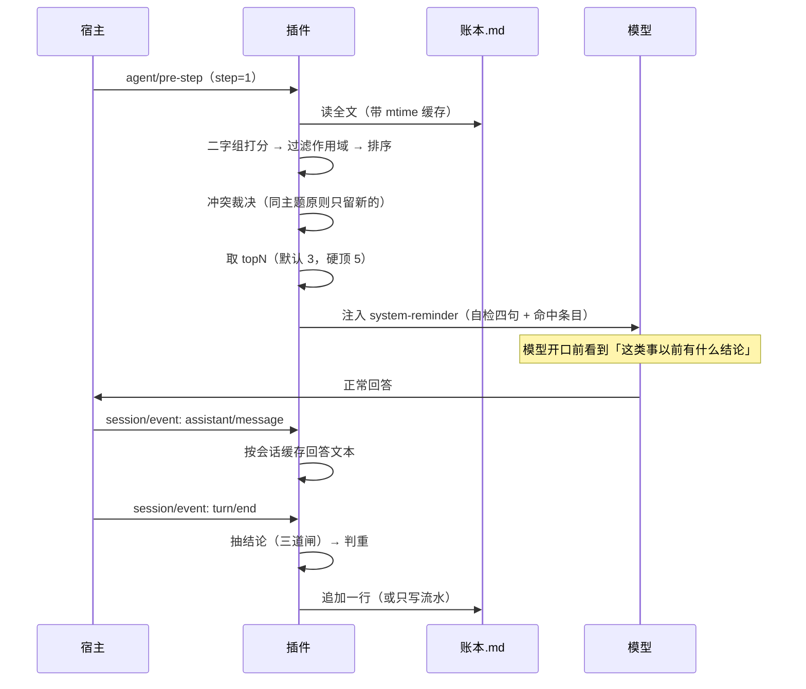
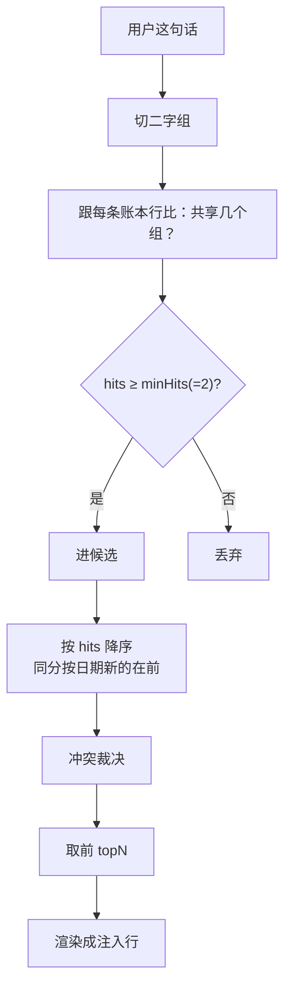
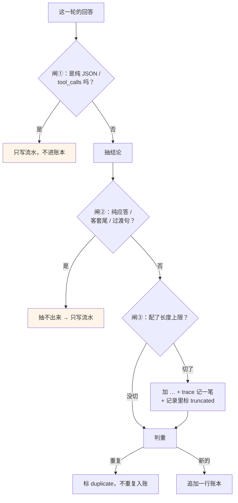
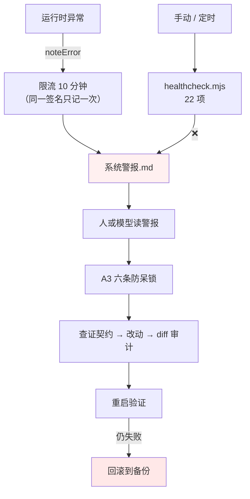

# 架构说明（ARCHITECTURE）

> 这份讲**为什么这么设计**，不是「怎么用」。用法看 README，改法看 DIY_GUIDE。

---

## 一、数据模型：三层，只有一个是真的


| 层 | 是什么 | 能删吗 | 谁写 |
|---|---|---|---|
| ① 事件流水 | 每轮一行 JSON，**只追加** | **不能**，删了就真没了 | 插件自动 |
| ② 账本 | 一行一条结论，带触发词和出处 | 能从①重算（如果实现了重建脚本） | 插件自动 + 人手写 |
| ③ 冷层 | 细则、长文、手册 | 能（但会丢上下文） | 人手写 |
| ④ 冷区 | 退役的规矩和记忆 | 能（但违反「只移不删」精神） | 人手移 |

**为什么要把「原始」和「派生」分开**：
派生件写坏了能重算，原始件写坏了就永久丢失。混成一层的系统，一次 bug 就能把历史烧掉。

**为什么账本只存「一行结论」而不是全文**：
每轮都要读它。全文进上下文会把预算烧光。
所以账本是**索引**，冷层才是正文 —— 这是「按 seq 去翻全文」这套设计的全部理由。

---

## 二、每轮发生了什么



**两个关键决定**：

1. **注入点选 `agent/pre-step` 的 step=1**，而且 `prepend: true`。
   太晚会和宿主自己的注入打架；每步都注入会把上下文灌满。

2. **沉淀等 `turn/end`，但回答要在 `assistant/message` 时就缓存**。
   因为 turn/end 那一刻 session 对象往往只剩一个 id，抓不到当时说了什么。
   这个坑是查会话日志才确认的 —— **不是猜的**。

---

## 三、检索算法（为什么是这些数字）



| 参数 | 默认 | 为什么是这个数 | 改大了会怎样 | 改小了会怎样 |
|---|---|---|---|---|
| `retrieveTopN` | **3** | 3 条 ≈ 200~400 token，够用不挤 | 挤占上下文，第 4 条开始命中质量明显下降（硬顶 5） | 漏检 |
| `retrieveMinHits` | **2** | 中文里一个二字组能撞几十上百条 | 误检暴涨（一堆不相干的条目） | 漏检 |
| `globalMemoryLines` | **12** | 「跨场景都成立的事实」通常不超过十几条 | 常驻膨胀 | 关键事实带不上 |

**为什么用二字组而不是分词或向量**：
- 分词要词典，中文领域词表永远不全
- 向量要模型和存储，部署成本翻十倍
- 二字组**零依赖、跨语言、够用** —— 对「找相似」这种粗粒度任务足够

**代价**：一个词只命中一个字就匹配不上。所以有 `minHits` 放宽兜底（严格档 0 命中 → 降到 1 再试一次）。

### 冲突裁决：只处理「原则」，而且刻意不做子句合并

同一主题的两条原则同时命中时，**只留日期新的那条**，旧的进 `superseded` 计数。

**为什么不做子句级合并**（把旧规里没被覆盖的部分剥出来继续给）：
那需要把句子切开再拼回去，**出错时很难察觉**。
宁可多留一条、并把「有旧版被取代」这件事说出来，也不做「看起来更聪明」的合并。

> 这条选择的代价是：**旧规里可能有一段仍然有效，但它被整条挂起了。**
> 如果实际使用中经常因此丢信息，再考虑做子句拆解 —— 但那时一定要先写测试。

---

## 四、沉淀算法（三道闸）



**三条闸的共同原则：宁可少记一条，也不记一条假的。**

账本里出现一条编出来的结论，比账本少一条严重得多 ——
因为**检索会把它当成事实喂回给模型**，错的东西会自己繁殖。

**截断必须留痕**：`maxAnswerChars` 默认 0（不截断）。如果配了上限，
切了就加 `…`，trace 记一笔，记录里标 `truncated: true`。
悄悄吃掉关键信息是最难查的故障 —— 文件里有、上下文里没有、还不报错。

---

## 五、自愈链



### 为什么要有独立的 `healthcheck.mjs`

写在插件里的自检，在**插件根本 import 不进来**时一次都跑不到。
所以体检脚本：
- **不 import 插件的任何文件**（只用子进程 + 静态读源码）
- 路径自己推导（跟 `config.js` 同一套规则，但不共享代码 —— 刻意重复一小段，换「插件坏了它也能跑」）

### 为什么 catch 不许静默

真实事故：8 处空 catch 吞掉了「索引读失败」，表现为「检索永远 0 命中」而没人知道。
更狠的是其中 5 处形如：

```js
} catch {
  return [];      // ← 看起来像"已经处理过了"，实际是把故障变成合法空值
}
```

**`return []` 比抛异常难查十倍**：抛异常会崩、会有人看见；`return []` 会让系统带着"零数据"继续跑。

所以叶子节点（`index-store`）的约定是：**不 throw、不自己写日志**，
而是返回 `{ ok: false, entries: [], errors: [...] }`，由上层决定要不要告诉模型「我瞎了」。

### 物理上限（诚实版）

**纯软件的自愈有天花板**：

| 场景 | 能救吗 |
|---|---|
| 宿主进程挂了、OS 还活着 | ✅ 守护进程能拉起 |
| 插件死循环 / import 就抛 | ✅ 体检能定位，回滚能恢复 |
| 内存耗尽引发换页风暴 | ⚠️ 大概率救不动 |
| 内核死锁 / 蓝屏 | ❌ **任何软件都无效，只能手动重启** |

**现场判据：看桌面还动不动。** 桌面能动 = 还有救；桌面卡死 = 别指望任何软件。

写这一节不是免责，是划清能力边界 ——
**一个不知道自己在哪失效的机制，比没有机制更危险**，因为它会让人误以为不需要备份。

---

## 六、已知失败模式（这些坑都真实踩过）

| 失败模式 | 表现 | 为什么会发生 | 现在的防线 |
|---|---|---|---|
| 分词规则不一致 | 命中率莫名偏低，不报错 | 建索引和检索各写一份分词 | 所有文本切分只留一个出口（`bigrams`） |
| 去重砍掉新版 | 留下的是「已被取代」那条 | 拿「标题前 40 字」当去重 key | A7：撞了必须读原文 |
| 静默吞异常 | 功能半瘫，日志干净 | 空 catch / `return []` | 叶子返回结构化错误 + 上层标降级 |
| 配置没校验 | 非法值一路穿到打分变 NaN | 定义了 schema 但只做合并 | `resolveConfig` 里真的跑一遍 schema |
| 装配文件缺失 | 装完了「毫无反应」 | `package.json` 指向的 patch 文件不存在 | 体检里加「装配声明」检查 |
| 工厂重复 new | 缓存永远失效 | 每次请求都 new 一次实例 | 入口只 new 一次 + 计数器断言 |

---

## 七、这套东西的边界（别期待错）

- **不是向量检索**。它找的是「字面相似」，不是「语义相近」。同义改写它找不到。
- **不是长期记忆**。账本是**摘要**，全文要按 seq 去冷层翻。它帮你「想起有这么回事」，不帮你「逐字复述」。
- **不替代判断**。它把「以前得出的结论」摆到你面前，但**要不要照做仍然是你的事** ——
  一条过期结论和一条现行命令长得一样，这条设计上没解决。
